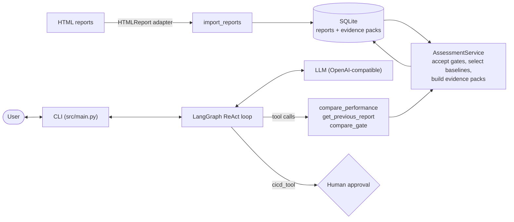

# Release Compass

Release Compass is a proof of concept (POC) for **evidence-based release
decisions through a chat interface**. It imports performance test reports,
checks each one against configured quality gates, and stores the results as
evidence packs that cannot be changed later. A language model (LLM) then
explains those results to the user.

The key design rule is that **the LLM never decides anything**. Calculating
metrics, choosing baselines, and deciding whether a gate passes or fails are all
done by ordinary Python code that always gives the same result for the same
input. The LLM gets those results only through tools and explains them.

The POC implements one gate, **Performance**. The architecture is built so that
other gates, such as Security or Functional Suitability, can be added later
without changing the chat or agent layers.

---

## Contents

1. [Key concepts](#key-concepts)
2. [Prerequisites](#prerequisites)
3. [Setup](#setup)
4. [Running the chat](#running-the-chat)
5. [Configuration](#configuration)
6. [How it works](#how-it-works)
7. [Repository layout](#repository-layout)
8. [Development workflow](#development-workflow)
9. [Documentation map](#documentation-map)
10. [Troubleshooting](#troubleshooting)

---

## Key concepts

| Term | Meaning |
| --- | --- |
| **Report** | One performance test report: an AI-SQUARE HTML file with embedded JSON. Each imported report gets a UUID. |
| **Gate** | One quality check on a report. The only gate today is Performance, which scores six metrics: response time, throughput, request outcomes, transaction NFR status, CPU, and memory. |
| **Gate acceptance / report acceptance** | Each gate gets its own outcome: `pass`, `fail`, or `unknown`. A report passes only if **every** gate passes ([ADR 0005](docs/adrs/0005_separate_gate_and_report_acceptance.md)). |
| **Baseline** | The reference used for comparison: the **most recent earlier report or gate that passed** ([ADR 0006](docs/adrs/0006_use_last_passed_gate_and_report_as_baselines.md)). The baseline for a gate and the baseline for the whole report can come from different reports. |
| **Predecessor** | The report that came immediately before, by date and time, including failed and unknown reports. This is not the same thing as the baseline. |
| **Evidence pack** | A stored JSON record for one report. It holds the current values, the baseline values, deltas, thresholds, outcomes, and where each value came from. Each pack belongs to one version of the assessment configuration. |
| **Provider assessment** | Scores or penalties that the report itself already contains. The Performance gate uses these values and compares them with configured thresholds ([ADR 0007](docs/adrs/0007_use_provider_performance_assessments.md)). |

## Prerequisites

- **[uv](https://docs.astral.sh/uv/)**: manages Python, the virtual environment,
  and dependencies. You do not need to install Python yourself, because uv
  installs the version given in `.python-version` (3.14).
- **An API key for an OpenAI-compatible LLM endpoint.** The default is
  [OpenRouter](https://openrouter.ai/). The model must support tool calling.

## Setup

```bash
git clone <repository-url> release-compass
cd release-compass
uv sync                     # creates .venv and installs runtime and dev dependencies
```

Create a file named `.env` in the **repository root**. It is ignored by git, so
it is never committed. Add your API key to it:

```dotenv
OPENROUTER_API_KEY=sk-or-...
```

The variable name must match `api_key_env` in the active LLM config. Only this
`.env` file is read. Shell environment variables are **not** used for the key
(see `src/llm/llm.py`).

## Running the chat

Run all commands from the repository root, because config paths are relative to
it:

```bash
uv run python -m src.main
```

At startup, the app does the following:

1. Imports the reports listed in `configs/application/local.yaml` into SQLite
   (`data/database/release_compass.sqlite3`, created automatically).
2. Assesses every stored report and writes its evidence packs.
3. Starts a chat about the **latest** stored report. The report's UUID is put
   into the system prompt.

Here are some example questions:

```text
You: Did the current report pass?
You: Which metric changed most compared to the baseline?
You: Show me the previous report.
You: Deploy it.          # starts the human-approval flow (see below)
```

Press `Ctrl+C` to quit. Chat history is kept in memory only and is lost when the
app exits. Imported reports and evidence stay in SQLite.

### Tools available to the LLM

| Tool | Purpose |
| --- | --- |
| `compare_performance(report_id)` | Returns the evidence pack for a report: outcomes, baselines that were selected automatically, deltas, and thresholds. |
| `get_previous_report(report_id)` | Returns the evidence pack of the previous report by date and time. At the first report, it returns `history_end: true`. |
| `compare_gate(report_id, baseline_report_id)` | Compares a report's Performance gate with a baseline report chosen explicitly ([ADR 0003](docs/adrs/0003_compare_gates_by_report_id.md)). |
| `cicd_tool()` | **Simulated** deployment trigger, guarded by human approval. |

### Deployment approval (human in the loop)

If the LLM calls `cicd_tool`, the graph **pauses** before the tool runs, and the
CLI asks:

```text
Do you approve triggering the CI/CD workflow? (yes/no)
```

- Only `yes` or `no` is accepted. Case does not matter. Any other answer is
  asked again.
- The tool runs at most **once per chat session**.
- The tool is refused if the LLM requests other tools in the same step.
- Today the tool only prints a message. It does not trigger a real pipeline.

For details, see [HITL_HANDLER.md](HITL_HANDLER.md).

## Configuration

All configuration is in YAML under `configs/` and is validated with Pydantic
models in `src/configs/`.

| File | Controls |
| --- | --- |
| `configs/application/local.yaml` | The SQLite path and the list of reports to import, with optional fallback timestamps. |
| `configs/gates/performance/performance_gate.yaml` | The acceptance threshold for each Performance metric (operator and score). |
| `configs/llm/openrouter.yaml` | The default LLM: model, base URL, the name of the key variable in `.env`, temperature, limits. |
| `configs/llm/self_hosted.yaml` | Template for a self-hosted vLLM server. |

### Adding a report

Add an entry to `configs/application/local.yaml`:

```yaml
data:
  reports:
    - path: data/raw/reports/my_new_report.html
      generated_at_date: "2026-10-01"   # only used if the HTML has no timestamp
      generated_at_time: "09:30:00"
```

Import follows these rules ([ADR 0008](docs/adrs/0008_incremental_import_and_history.md),
[ADR 0009](docs/adrs/0009_require_complete_report_timestamps.md)):

- **Reports are identified by content.** The SHA-256 hash of the HTML identifies
  a report. Importing the same file again, even under a new name, reuses the
  stored UUID. A changed file is imported as a new report.
- **A complete timestamp is required.** The HTML timestamp is used first. If the
  HTML has none, the config date and time are used. If a timestamp is
  incomplete, or neither source has one, the report is rejected. The current
  time is never used as a substitute.
- **Backdated reports are not allowed.** A new report that is older than the
  latest stored report is rejected, and nothing from that batch is written.

More sample reports are in `data/raw/reports/example_reports/`.

### Changing thresholds

Edit `performance_gate.yaml` and restart. If the configuration changed, the
history is rebuilt under a new assessment version. Evidence packs that were
already stored are not changed.

### Switching the LLM

Any OpenAI-compatible endpoint works ([ADR 0001](docs/adrs/0001_use_openai_compatible_llm_client.md)).
To use the self-hosted config:

1. Fill in `model_name` and `base_url` in `configs/llm/self_hosted.yaml`.
2. Add the matching key to `.env` (for example `VLLM_API_KEY=...`).
3. Change `LLM_CONFIG_PATH` in `src/main.py` to that file. There is no CLI flag
   for this yet.

Validation limits: `max_completion_tokens` must be 1–1024 and `max_retries` must
be 2–4.

### Resetting local state

```bash
rm -rf data/database/       # the next run re-imports and re-assesses everything
```

## How it works



The code follows a **hexagonal (ports and adapters)** structure
([ADR 0002](docs/adrs/0002_use_hexagonal_boundry_for_ingestion.md)):

- The **domain** contains the gate rules and evidence types. It does not do any
  I/O.
- The **application** contains the use cases (import, assess, compare). It
  defines *ports*, which are the interfaces it needs.
- The **adapters** implement those ports: an HTML parser and a SQLite
  repository.
- The **harness** is the LangGraph agent. It converts use cases into tools that
  the LLM can call.

`src/main.py` only loads configuration and connects these parts.

For the full design, read
[ARCHITECTURE.md](docs/implementation/architecture_overview/ARCHITECTURE.md).

## Repository layout

```text
configs/                 YAML configuration (application, gates, llm)
data/raw/reports/        Sample AI-SQUARE HTML reports
data/database/           Local SQLite DB (git-ignored, created on first run)
docs/
  adrs/                  Architecture Decision Records — source of truth for design
  implementation/        Architecture, POC goals, tools, ontology drafts, discussions
  papers/                Background research
src/
  main.py                Entry point: config loading, wiring, CLI chat loop
  domain/                Pure domain model: Report, gates, assessment, evidence, history, deltas
  application/
    use_cases/           import_reports, assess_reports, compare_gate
    ports/outbound/      Interfaces: report reader/writer/history/ingestion
    performance_assessment.py   Builds the Performance AssessmentService
  adapters/outbound/     html_report.py (parser), sqlite_report_repository.py
  configs/               Pydantic models + loaders for the YAML files
  harness/               LangGraph graph, state, system prompt, tools, HITL interrupt handler
  llm/                   ChatOpenAI construction and .env key lookup
tests/                   Mirrors src/ (unit tests) + integration/ (end-to-end lifecycle)
```

## Development workflow

### Checks

```bash
uv run python -m unittest discover -s tests   # tests (standard library unittest)
uv run ruff check .                           # lint
uv run ruff format --check .                  # formatting
uv run ty check                               # type check
```

The tests do not call a real LLM and do not need `.env`.

### Conventions

These are taken from [AGENTS.md](AGENTS.md), which applies to people and AI
agents alike:

- Keep changes small and focused, and keep them consistent with the existing
  code.
- Use **absolute imports** that start with `src.`, for example
  `from src.domain.report import Report`.
- Use Python 3.14+ and keep dependencies minimal. Discuss a new dependency
  before adding it with `uv add <package>`.
- Add or update tests when behavior changes. Put each test at the path in
  `tests/` that mirrors its source file.
- **ADRs are the source of truth.** Read the relevant ADRs before you change
  behavior they cover. Propose a new or updated ADR (template:
  `docs/adrs/0000_template_adr.md`) and get it approved before you change a
  design decision.
- Keep documentation concise, and give sources for research claims.

### Adding a new gate

The gate contract is described in
[ARCHITECTURE.md § Metric-independent gate contract](docs/implementation/architecture_overview/ARCHITECTURE.md#metric-independent-gate-contract).
In short, a new gate needs four things:

- a report adapter or parser for its data;
- a gate definition in `src/domain/gates/<gate>/`;
- threshold config in `configs/gates/<gate>/`;
- registration: a `GateDefinition` passed to the `AssessmentService` (see
  `src/application/performance_assessment.py`), serialization types for the
  SQLite repository (see `PERFORMANCE_DOMAIN_TYPES` in `src/main.py`), and its
  tools in `src/harness/tools/build_tools.py`.

The LLM and the client layers should not need any changes.

## Documentation map

| Read this | When you want to |
| --- | --- |
| [ARCHITECTURE.md](docs/implementation/architecture_overview/ARCHITECTURE.md) | Understand the layers and the request and evidence flow |
| [POC_GOALS.md](docs/implementation/poc_goals/POC_GOALS.md) | See which metrics are in scope, which report fields they come from, and what is a non-goal |
| [docs/adrs/](docs/adrs/) | Understand why something is built the way it is (ADRs 0001–0009) |
| [tools.md](docs/implementation/tools/tools.md) | See the input and output contracts of the LLM tools |
| [HITL_HANDLER.md](HITL_HANDLER.md) | Understand how the approval interrupt and resume flow works |
| [ontology/README.md](docs/implementation/ontology/README.md) | Read the draft domain ontology and the questions it must answer (under discussion) |
| [ai_sqaure_ontology/](docs/implementation/ai_sqaure_ontology/README.md) | See the schema of the report provider's ontology |
| [NEXT_IDEAS.md](NEXT_IDEAS.md) | See possible future work |
| [discussions/](docs/implementation/discussions/) | Read the history of POC design discussions |

## Troubleshooting

| Symptom | Cause / fix |
| --- | --- |
| `RuntimeError: Missing OPENROUTER_API_KEY in .../.env` | `.env` is missing, is not in the repository root, or uses a different variable name than `api_key_env`. |
| `FileNotFoundError: configs/...` | You are not running from the repository root. |
| `Backdated import rejected: <path>` | The new report is older than the latest stored report. Either delete `data/database/` to rebuild from scratch, or import reports in date order. |
| `Report <path> has no complete generated-at timestamp` | Add both `generated_at_date` and `generated_at_time` to the report's config entry. |
| `At least one stored report is required for chat` | `data.reports` is empty, or no report was imported. |
| The LLM answers without calling any tools, or the tool calls fail | The model may not support tool calling. Try a different `model_name`. |
| uv warns that `VIRTUAL_ENV` does not match | Another environment is active in your shell. Run `deactivate` or `unset VIRTUAL_ENV`. |
