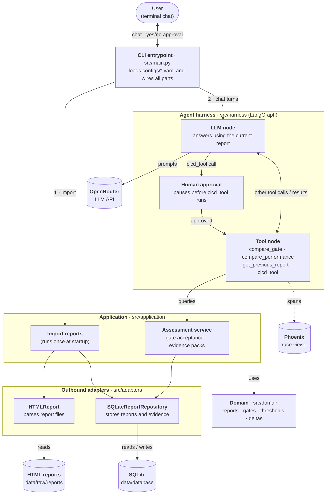

# release-compass

## Architecture



Run the local conversational POC:

```bash
uv run python -m src.main
```

Local report paths, fallback timestamps, and the SQLite path are configured in
`configs/application/local.yaml`; metric acceptance thresholds are in
`configs/gates/performance/performance_gate.yaml`. LLM configuration is loaded
from `configs/llm/openrouter.yaml`, with its named API key read from `.env`.

Startup imports unseen report content, prepares versioned acceptance/evidence,
and uses the latest stored report as chat context. Repeat imports reuse stored
UUIDs; later backdated additions are rejected. The agent explains deterministic
results through `compare_performance` and `get_previous_report`.

## Trace

Agent runs are traced to a local Phoenix server, which starts automatically
with the agent (log: `data/harness/phoenix.log`).

To view traces, open [localhost:6006](http://localhost:6006) and select the
**release-compass** project.

Tracing is configured in `configs/trace/trace.yaml`:

- `enabled: false` turns tracing off.
- `auto_start: false` skips launching Phoenix, so you run it yourself.

## Environment

API keys are read only from the `.env` file in the project root (values set in the shell are ignored). The key needed depends on the `api_key_env` field of the LLM config in use:

| Key | Used by | Description |
| --- | --- | --- |
| `OPENROUTER_API_KEY` | `configs/llm/openrouter.yaml` | API key for OpenRouter |

Example `.env`:

```dotenv
OPENROUTER_API_KEY="sk-or-..."
```
