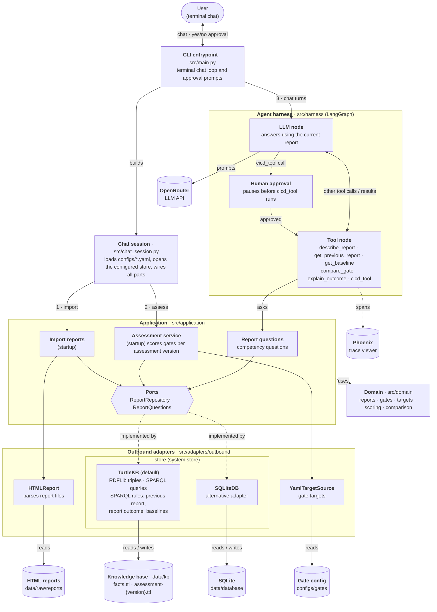

# release-compass

release-compass is a conversational agent harness for DevOps release decisions.
It imports load-test reports of a system under test (currently Locust HTML
reports), stores them in an ontology-based knowledge base (or SQLite), and
checks each report deterministically against configured performance gates and
the last accepted baseline. In a terminal chat, an LLM agent explains these
results (gate outcomes, metric deltas, report history) and can trigger a CI/CD
action, but only after explicit human approval. Agent runs are traced in
Phoenix.

## Quick start

```bash
curl -LsSf https://astral.sh/uv/install.sh | sh  # 1. install uv (once)
uv sync                                          # 2. install Python 3.14 and the locked dependencies
cp .env.example .env                             # 3. then set OPENROUTER_API_KEY
uv run python -m src.main                        # 4. import reports and start the chat
```

See [uv installation](https://docs.astral.sh/uv/getting-started/installation/)
for other install methods, and [Environment](#environment) for the `.env` file.

## Architecture



Startup imports unseen report content, assesses unassessed reports for the
current assessment version, and uses the latest stored report as chat context.
Repeat imports reuse stored UUIDs; later backdated additions are rejected. The
agent explains deterministic results through its report tools (`describe_report`,
`get_previous_report`, `get_baseline`, `compare_gate`, `explain_outcome`).

## Docker

The `docker/` folder runs the agent together with a Phoenix trace server. All
commands are run from the repository root.

| File | Purpose |
| --- | --- |
| `docker/Dockerfile` | Agent image: installs locked dependencies with `uv`, copies `configs/` and `src/` |
| `docker/Dockerfile.dockerignore` | Restricts the build context to what the Dockerfile copies |
| `docker/compose.yaml` | Services `agent` (interactive chat) and `phoenix` (traces on port 6006) |
| `docker/trace.yaml` | Replaces `configs/trace/trace.yaml` in the container so traces go to the `phoenix` service instead of a self-started server |

```bash
cp .env.example .env                                 # then set your API key
docker compose -f docker/compose.yaml build
docker compose -f docker/compose.yaml run --rm agent # interactive chat
docker compose -f docker/compose.yaml down           # stop Phoenix afterwards
```

For the `.env` file, see [Environment](#environment).

Traces are available at [localhost:6006](http://localhost:6006) while Phoenix
is running.

`.env` and `data/` are mounted at runtime and never baked into the image:

- `.env` is mounted read-only to `/app/.env`; it must exist before `run`
  (see [Environment](#environment)).
- `data/` is mounted read-write to `/app/data`, so report inputs are read from
  the host and the knowledge base (or SQLite database) persists across runs.

`configs/` is copied into the image, so rebuild after changing
`configs/application/local.yaml` or any other config file.

## Data and configuration

### Configuration files

| File | Configures |
| --- | --- |
| `configs/application/local.yaml` | Report inputs, storage backend, fallback timestamps (see [below](#application-config)) |
| `configs/gates/performance/performance_gate.yaml` | Metric acceptance thresholds |
| `configs/ingestion/*.yaml` | How values are extracted from each tool's HTML report |
| `configs/llm/openrouter.yaml` | LLM settings; its named API key is read from `.env` (see [Environment](#environment)) |
| `configs/trace/trace.yaml` | Tracing (see [Trace](#trace)) |

### Adding a report

1. Export the load-test report as HTML (currently Locust's HTML report).
2. Place the file under `data/raw/reports/` (e.g. `data/raw/reports/<project>/<name>.html`).
3. Add an entry with its `path` and `source` to `data.reports` in
   `configs/application/local.yaml`, in chronological order.
4. Run the agent; startup imports reports not yet stored. In Docker, rebuild
   the image first, since `configs/` is baked in.

A report from another tool needs its own mapping file under
`configs/ingestion/` registered in `ingestion.mappings`.

### Application config

`configs/application/local.yaml` tells the import which reports to load and
where to store them. Paths are relative to the repository root (`/app` in
Docker), so reports must live under `data/` to be visible in the container.

```yaml
system:
  store: knowledge_base   # or sqlite
  kb_dir: data/kb         # required when store is knowledge_base
  db_path: data/database/release_compass.sqlite3  # required when store is sqlite

ingestion:
  mappings:
    locust: configs/ingestion/locust.yaml   # source name -> HTML mapping

data:
  reports:
    - path: data/raw/reports/<...>/Locust_TeaStore_Report_Original.html
      source: locust
      # Optional fallback, only used if the report has no timestamp itself;
      # both fields must be given together.
      # generated_at_date: "2026-09-02"
      # generated_at_time: "10:00:00"
```

- `system.store` selects the repository adapter; only the matching path
  (`kb_dir` or `db_path`) is required. Both are generated and git-ignored.
- `ingestion.mappings` maps each source name to a mapping file that describes
  how values are extracted from that tool's HTML report (e.g.
  `configs/ingestion/locust.yaml` for Locust).
- `data.reports` lists the HTML report files to import. Each `source` must be a
  key in `ingestion.mappings`. Every report needs a complete generated-at
  timestamp, either from the report itself or from the fallback fields.
- Reports are expected under `data/raw/reports/`; the TeaStore examples in
  `data/raw/reports/example_reports/` are configured by default.
- Imports are ordered by timestamp; adding a report older than the latest
  stored one is rejected.

## Trace

Agent runs are traced to a local Phoenix server, which starts automatically
with the agent (log: `data/harness/phoenix.log`).

To view traces, open [localhost:6006](http://localhost:6006) and select the
**release-compass** project.

Tracing is configured in `configs/trace/trace.yaml`:

- `enabled: false` turns tracing off.
- `auto_start: false` skips launching Phoenix, so you run it yourself.

## Environment

API keys are read only from the `.env` file in the project root (values set in the shell are ignored). The key needed depends on the `api_key_env` field of the LLM config in use:

| Key | Used by | Description |
| --- | --- | --- |
| `OPENROUTER_API_KEY` | `configs/llm/openrouter.yaml` | API key for OpenRouter |

Create `.env` from the template [`.env.example`](.env.example):

```bash
cp .env.example .env
```

```dotenv
OPENROUTER_API_KEY="sk-or-..."
```
