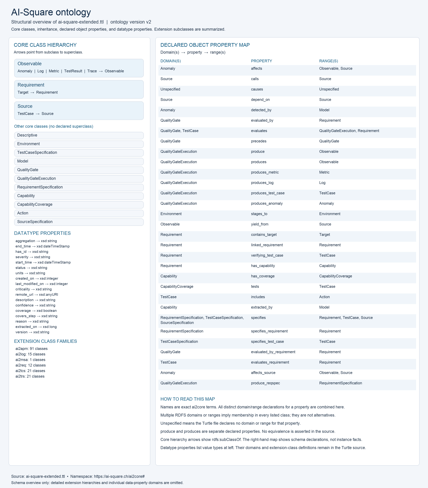
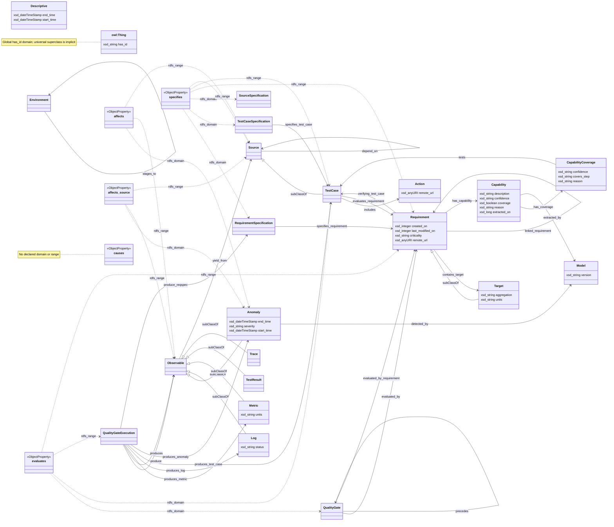

# AI-Square ontology

The image summarizes [ai-square-extended.ttl](ai-square-extended.ttl): 21 core
classes, their declared inheritance, 31 object properties, 18 datatype
properties, and counts for 161 extension classes. Detailed extension hierarchies
and datatype-property domains are omitted.

Multiple domain/range declarations are shown together. In RDFS these imply
membership in every listed class, rather than alternatives; see the
[W3C RDF Schema specification](https://www.w3.org/TR/rdf-schema/#ch_domain).

## Mermaid schema diagram

The diagram uses exact `ai2core` class and property names. Inheritance arrows
point to the superclass; labeled solid arrows show object-property domains and
ranges. Properties with multiple domains or ranges are represented as explicit
`ObjectProperty` nodes with dotted declaration links, preserving the conjunction
semantics described above. `causes` has no declared domain or range.

Class attributes show datatype properties and their value types (`xsd_` means
`xsd:`). Attributes shared across multiple declared domains appear on each class.
`owl:Thing` is shown separately for the global `has_id` property. The diagram
covers the same core schema as the image; the 161 extension classes are summarized
in the image rather than expanded here.

