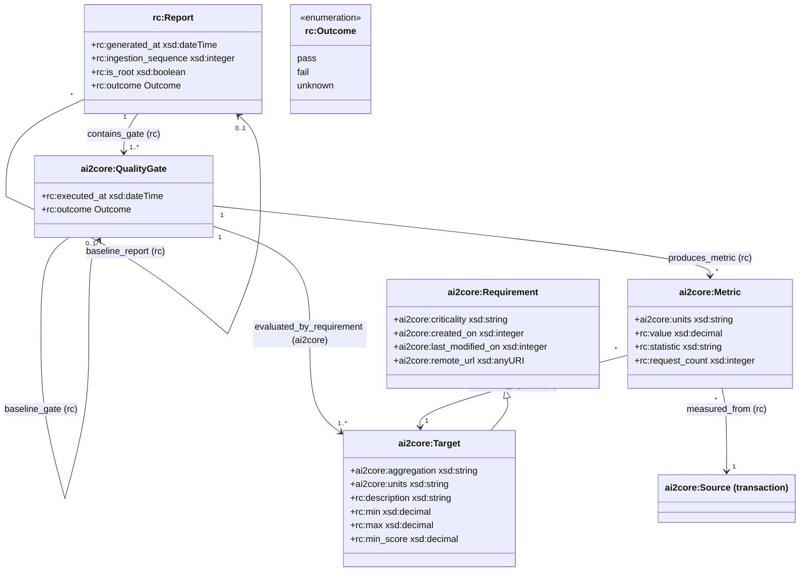

# Questions the ontology must support

1. **What does a report describe?** Identify its project, system, software
   version, execution, environment, and workload.
2. **Which report immediately preceded it?** Retrieve its chronological
   predecessor within a defined history scope, including failed and unknown
   reports, or identify the beginning of that history.
3. **Which baseline applies, and why?** Distinguish the report baseline from
   each gate's baseline and explain the selection policy and version.
4. **Are particular measurements comparable?** Check their subjects, metric
   meanings, statistics, units, measurement procedures, and execution contexts;
   explain incompatibility or missing information.
5. **What changed?** Retrieve matched current and baseline observations and
   their deterministic comparison results.
6. **Why did a gate or report pass, fail, or remain unknown?** Retrieve the
   applicable requirements, assessment policy, outcomes, and supporting evidence.
7. **Where did an answer come from?** Trace it to source reports, field
   locations, and the analysis activity that produced a derived result.
8. **What information is missing?** Distinguish unavailable evidence, an
   unavailable baseline, and an analysis that has not been performed.

## KISS ontology

Rendered from the hand-drawn sketch [ontology.png](ontology.png). Classes
prefixed `ai2core:` are reused from AI-Square
([ai-square-extended.ttl](../ai_sqaure_ontology/ai-square-extended.ttl)) with
their declared attributes; `rc:` marks the release-compass extension, including
attributes added to reused classes. Mermaid relation labels cannot contain a
colon, so `precedes (ai2core)` means `ai2core:precedes`. `ai2core:has_id`
applies to every class and is omitted.

Changes from the sketch:

- **One `QualityGate` node.** `ai2core:QualityGateExecution` is merged into
  `ai2core:QualityGate`, which takes its `rc:executed_at` and `rc:outcome`. A
  `QualityGate` instance is one gate run within a report, so
  `ai2core:evaluates` is dropped and `rc:contains_execution` and
  `rc:baseline_execution` become `rc:contains_gate` and `rc:baseline_gate`.
  `rc:produces_metric` replaces `ai2core:produces_metric`, whose domain
  `ai2core:QualityGateExecution` would otherwise be inferred for every gate.
- **One `Target` node.** The two `RequirementTarget` boxes are merged.
  `ai2core:Target` is a subclass of `ai2core:Requirement`, so it is a valid
  range of `ai2core:evaluated_by_requirement`. A gate has several targets (one
  per metric, ADR 0012), so the cardinality is `1..*`, not `1:1`.
- **Assessing a metric.** `ai2core:aggregation` (e.g. `p90`) and the
  `rc:min`/`rc:max` range answer “how is a metric assessed?” (ADR 0012).
  A metric matches its target when `rc:statistic` equals the aggregation and
  the units are equal. `description` and the range are `rc:` additions, since
  AI-Square declares neither on `Target`.
- **Metric is a measurement.** It is produced by one gate run
  (`rc:produces_metric`, `1:*`), not shared `n:n` between gates.
- **Metric maps directly to Source.** `ai2core:Observable` is removed.
  `rc:measured_from` links each metric to its measured transaction for
  per-transaction scoring. `ai2core:yield_from` is not reused because its
  domain `ai2core:Observable` would reintroduce the removed class.
- **Predecessor instead of child.** `rc:previous_report` with `rc:is_root`
  keeps stored reports immutable when a new report arrives (ADR 0006, ADR 0008).
- **Rules, not stored facts.** Report `rc:outcome` is the conjunction of its
  gate outcomes (ADR 0005). `rc:baseline_report` and `rc:baseline_gate` are
  selected by the latest-passing rule (ADR 0006); without a separate gate
  definition, gates are comparable when they are evaluated by the same
  targets.
- **Not reused.** `ai2core:evaluated_by` is declared twice with different
  domains, so only `ai2core:evaluated_by_requirement` is used.

## Tech stack

AI-Square models its knowledge graph in RDF, maps source data to it with
RML/YARRRML, and lets agents query it with SPARQL
([Mosquera et al., 2025](https://ceur-ws.org/Vol-3959/PT-paper3.pdf), §2.3);
its vocabulary is published as OWL in Turtle
([ai-square-extended.ttl](../ai_sqaure_ontology/ai-square-extended.ttl)). The
paper names no triple store. Release-compass follows the same standards:

| Layer | Choice | Purpose |
| --- | --- | --- |
| Ontology language | [OWL 2](https://www.w3.org/TR/owl2-overview/) / [RDFS](https://www.w3.org/TR/rdf-schema/) in [Turtle](https://www.w3.org/TR/turtle/) | `rc:` vocabulary in its own `.ttl` file that reuses `ai2core:` terms, as in the diagram above. |
| Editor (optional) | [Protégé](https://protege.stanford.edu/) | Visual editing and consistency checks of the `.ttl` file. |
| Data | RDF instance triples | Reports, gates, metrics, and sources as `rc:`/`ai2core:` individuals. |
| Mapping | Python ingestion adapters | Existing adapters emit triples directly. [RML/YARRRML](https://rml.io/yarrrml/), as used by AI-Square, is the declarative alternative if mappings should live outside code. |
| Library and store | [RDFLib](https://rdflib.readthedocs.io/) | Parse and serialize Turtle, hold the graph in memory or in a file, and run SPARQL in-process. A server store (e.g. Apache Jena Fuseki) is only needed for shared or large graphs. |
| Query | [SPARQL 1.1](https://www.w3.org/TR/sparql11-query/) | One query per competency question above. |
| Validation (optional) | [SHACL](https://www.w3.org/TR/shacl/) via [pySHACL](https://github.com/RDFLib/pySHACL) | Required fields, cardinalities, and allowed `rc:Outcome` values. |

[02_discussion.md](../discussions/02_discussion.md) lists
[pyRDF](https://pypi.org/project/pyRDF/), but it is a lightweight RDF stream
parser without SPARQL support, so RDFLib replaces it. Adding RDFLib (and
pySHACL) requires `uv add rdflib` (`uv add pyshacl`).
