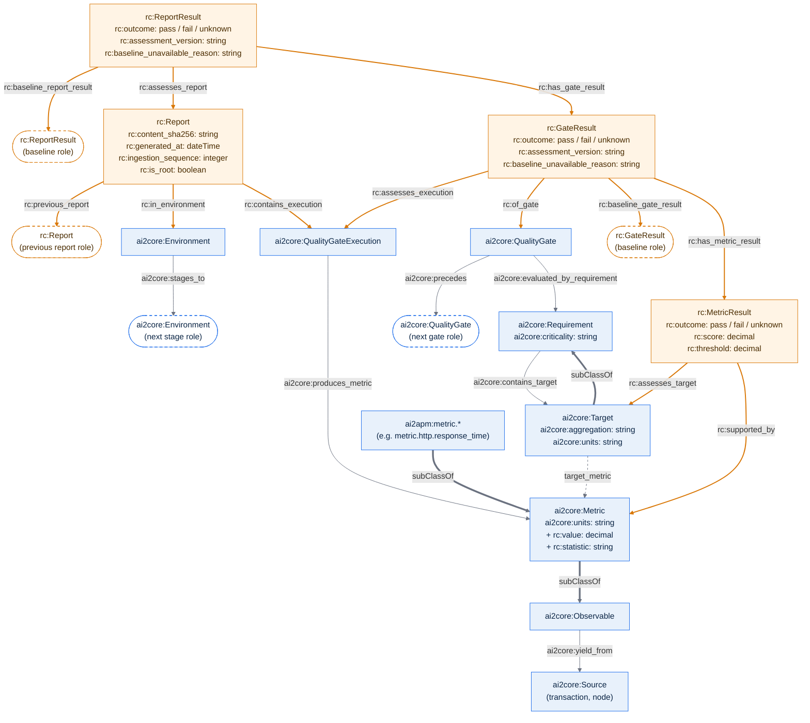

# Questions the ontology must support

1. **What does a report describe?** Identify its project, system, software
   version, execution, environment, and workload.
2. **Which report immediately preceded it?** Retrieve its chronological
   predecessor within a defined history scope, including failed and unknown
   reports, or identify the beginning of that history.
3. **Which baseline applies, and why?** Distinguish the report baseline from
   each gate's baseline and explain the selection policy and version.
4. **Are particular measurements comparable?** Check their subjects, metric
   meanings, statistics, units, measurement procedures, and execution contexts;
   explain incompatibility or missing information.
5. **What changed?** Retrieve matched current and baseline observations and
   their deterministic comparison results.
6. **Why did a gate or report pass, fail, or remain unknown?** Retrieve the
   applicable requirements, assessment policy, outcomes, and supporting evidence.
7. **Where did an answer come from?** Trace it to source reports, field
   locations, and the analysis activity that produced a derived result.
8. **What information is missing?** Distinguish unavailable evidence, an
   unavailable baseline, and an analysis that has not been performed.

## Proposed conceptual graph

This is a **draft for discussion**, not an accepted architecture decision. The
release-compass ontology reuses the AI-Square core
([ai-square-extended.ttl](../ai_sqaure_ontology/ai-square-extended.ttl)) and
extends it with reports, assessment results, history, and baselines from
[ADR 0005](../../adrs/0005_separate_gate_and_report_acceptance.md),
[ADR 0006](../../adrs/0006_use_last_passed_gate_and_report_as_baselines.md),
[ADR 0007](../../adrs/0007_use_provider_performance_assessments.md), and
[ADR 0008](../../adrs/0008_incremental_import_and_history.md).

Legend:

- **Blue nodes and grey arrows** are reused from AI-Square (`ai2core:`,
  `ai2apm:`).
- **Orange nodes and orange arrows** are the release-compass extension (`rc:`).
  Attributes prefixed with `+ rc:` extend a reused class.
- **Thick arrows** are `rdfs:subClassOf`; other arrows read from subject to
  object, for example “ReportResult `rc:has_gate_result` GateResult”.
- **Rounded, dashed nodes** are roles, not extra classes. A property whose
  domain and range are the same class (for example `rc:previous_report`) links
  two *instances* of that class; the role node shows the second instance, for
  example “Report `rc:previous_report` Report (previous report role)”.
- The **dotted arrow** `target_metric` appears in the AI-Square diagram but is
  not declared in the Turtle file.
- `ai2core:has_id` applies to every class (domain `owl:Thing`) and is omitted.

Design notes:

- **Report facts are separate from assessment results.** A report's identity,
  timestamp, ingestion sequence, and predecessor do not change. Outcomes and
  baselines depend on the assessment version, so `rc:ReportResult`,
  `rc:GateResult`, and `rc:MetricResult` carry `rc:assessment_version`, and a
  report can have several results (ADR 0007, ADR 0008).
- **Predecessor and baseline differ.** `rc:previous_report` follows report
  chronology and includes failed and unknown reports. The baseline links point
  to the latest passing result, and a gate baseline can come from a different
  report than the report baseline (ADR 0006).
- **Metric results explain gate outcomes.** Performance passes only when all
  six metric outcomes pass (ADR 0007); `rc:MetricResult` records each outcome
  against its `ai2core:Target`.
- **`rc:of_gate` replaces `ai2core:evaluates`.** The Turtle file declares
  `evaluates`, `evaluated_by`, and `specifies` several times with different
  domains and ranges; under RDFS these combine, so they are not reused.
- **AI-Square adds a value to Metric.** `ai2core:Metric` declares `units` but no
  value, so `rc:value` and `rc:statistic` extend it.

## Meaning of the relationships

- **Report, run, and assessment have separate identities.** A run can have
  several report artifacts. The same evidence can support assessments under
  different policy versions without replacing earlier results.
- **Definitions are distinct from occurrences.** Response time is a metric
  definition; p90 is a statistic; the Performance gate is a gate definition.
  Their measurements and assessments are individual occurrences. Provider and
  transaction names do not become classes in the shared ontology.
- **Measured subjects have scoped identities.** Transactions and components
  belong to their system/project. Equal display names do not establish identity
  across providers or projects. The “is a kind of” arrows express class
  specialization; other arrows describe relationships between instances.
- **Baseline is a role.** A baseline assessment is an ordinary assessment
  selected for another assessment under a policy. Likewise, a baseline
  observation is an ordinary observation used as a comparison input. These
  diagram nodes do not introduce separate entity identities or mandatory classes.
- **Selection has an explicit result.** A successful selection identifies one
  baseline at the corresponding gate/report level. An unavailable selection has
  a reason and no selected baseline. No selection result means the operation has
  not been recorded, rather than proving that no eligible baseline exists.
- **Predecessor and baseline differ.** History positions include failed and
  unknown reports. Passing-baseline selection follows its versioned policy.
  Gate and report baselines can originate from different reports.
- **Comparability applies to particular inputs.** One pair of reports may
  support a response-time comparison while lacking comparable CPU evidence.
  Compatibility is compatible, incompatible, or unknown under a specified
  policy. A computable numeric difference alone does not establish compatibility.
- **Results retain provenance.** Analysis activities record their inputs and
  policy versions. A derived relationship is accompanied by its selection or
  comparison result, reasons, and evidence references.
- **This is the common core.** Numeric observations are shown explicitly for
  the Performance use case. Additional gates may introduce other evidence/result
  types without changing report, assessment, history, or provenance semantics.

## Semantics reused from official vocabularies

The graph uses plain domain names. The table specifies the proposed formal
alignments; it does not assert that similarly named concepts are equivalent.

| Official vocabulary | Semantics reused | Application in this proposal |
| --- | --- | --- |
| [W3C PROV-O](https://www.w3.org/TR/prov-o/) | **Entity**, **Activity**, **Agent**; **used**, **wasGeneratedBy**, **wasDerivedFrom**, **wasAssociatedWith** | Reports, policy versions, assessment results, selections, and comparisons specialize Entity. Runs and analysis specialize Activity. Responsible software/persons use Agent. Generation and input links record provenance; derived-from links are asserted where a result actually derives from an input. |
| [W3C SOSA/SSN](https://www.w3.org/TR/vocab-ssn/) | **Observation**, **ObservableProperty**, **FeatureOfInterest**, **Procedure**; **observedProperty**, **hasFeatureOfInterest**, **usedProcedure**, **hasResult**, **phenomenonTime** | Observation measures a property of a subject using a procedure, with a result and observation time. Metric definitions specialize ObservableProperty. Measured subjects use FeatureOfInterest. Statistic remains an explicit local concept. |
| [QUDT](https://qudt.org/pages/QUDToverviewPage.html) | **QuantityValue**, **Unit**, **QuantityKind**; numeric value and unit semantics | Numeric measurement results carry values and identified units. Quantity kinds describe the quantity measured. Provider units retain their original representation and are mapped only when meaning is verified. Conversion requires an explicitly supported implementation. |
| [W3C RDF Schema](https://www.w3.org/TR/rdf-schema/) | Classes, subclass relationships, labels, comments, property domains and ranges | Define the vocabulary and class specialization. Domain/range declarations express inference semantics; required fields are specified separately. |
| [W3C OWL 2](https://www.w3.org/TR/owl2-overview/) | Selected class/property axioms, including equivalence, disjointness, and inverse relationships when justified | Add only axioms needed by the competency questions. A mapping to a provider term does not automatically justify equivalence or identity. |

## Project-specific semantics

The following require our own definitions rather than being supplied by the
reused vocabularies:

- Software-delivery context: project, system, software version, workload,
  environment, and history scope.
- Report-to-run association and precise source/stored-evidence references.
- Metric statistics, requirements, gate definitions, gate assessments, report
  assessments, and assessment outcomes.
- Baseline-selection policies, eligibility, selection status, and reasons.
- Comparison policies, compatibility decisions, and difference results.
- Chronological history positions, ordering, and predecessor relationships.

Provider-specific mappings, including
[AI-Square](../ai_sqaure_ontology/ai-square-extended.ttl), belong in separate
mapping modules. The shared core must not depend on AI-Square field names or
import its complete class hierarchy. Existing terms are aligned individually
after their meanings have been checked.

## Validation and derivation

[W3C SHACL](https://www.w3.org/TR/2017/REC-shacl-20170720/) supplies validation
semantics, rather than domain concepts: required fields, cardinalities, allowed
outcomes, and value types. Missing comparison context can leave a comparison
unknown while still permitting evidence retrieval.

Deterministic, versioned rules select baselines, evaluate compatibility, compute
differences, and assess gates. The ontology describes the meanings and results
of these operations; it does not by itself implement “latest eligible passing
assessment” selection. Each question above needs example data and an expected
answer, including missing-data and cross-project cases.

**Open decisions:** define history scopes and the context conditions required
by each comparison policy. Adding compatibility restrictions to baseline
eligibility would extend the current policy and requires an approved ADR change.
