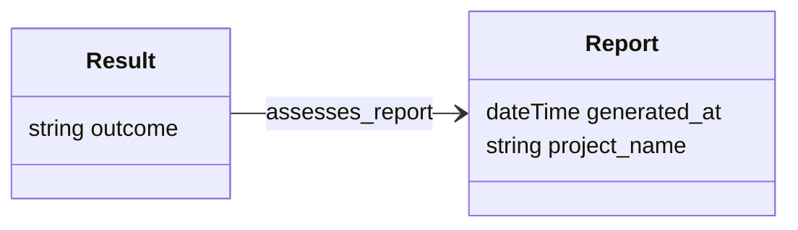
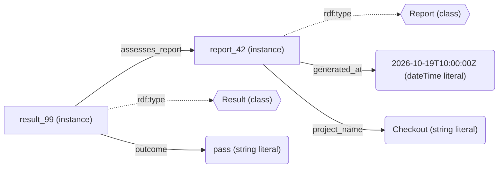
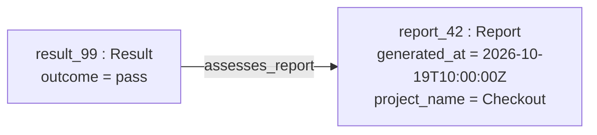

# Ontology schema and knowledge-base instances

This illustration uses proposed names, not an implemented ontology.

## Schema: what kinds of things and properties exist?

Like the AI-Square overview, this diagram shows **classes**, not instances.
Rows inside a box show datatype properties and their value types. Labeled
arrows show object properties between instances of the connected classes.
Grouping properties inside a class box is a drawing convention; RDF properties
are defined separately from classes.

Read the arrow as: “A Result instance can assess a Report instance.” It is
similar to a foreign key from a Result table to a Report table. This diagram
does not specify required fields or cardinalities.

In the AI-Square image, hollow triangle arrows represent **subclass-of**
(inheritance), labeled association arrows represent **object properties**, and
`1` / `*` indicate multiplicities. Such annotations express the intended schema;
whether the ontology formally encodes or validates them must be checked separately.

## Data: which particular things exist, and what do we know about them?

This graph draws all six example RDF statements. Each arrow is a property;
its source is the statement's subject and its destination is the object.
`rdf:type` links an instance to its class. Literal values are shown in rounded
boxes, instances in rectangular boxes, and classes in hexagonal boxes.

For example, `result_99 -- assesses_report --> report_42` is one concrete
statement. `Result -- assesses_report --> Report` in the schema diagram
describes the kinds of things that can participate in that relationship.

The same instances can also be drawn in a compact, row-like form. Here the
rows contain **actual values**, rather than the schema's property types:

The last two diagrams describe the same data. The compact drawing folds the
literal-value statements and class memberships into the instance boxes.
